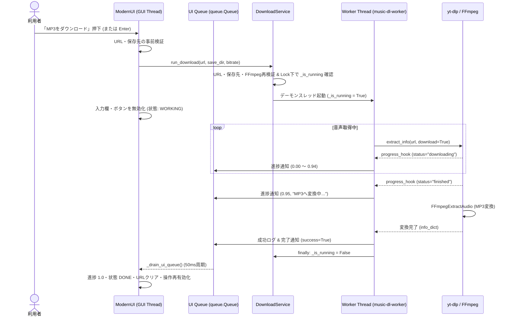

# 詳細設計：アーキテクチャ（Music DL）

本書は、Music DL（`music_dl`）のモジュール構成、レイヤー間の責務と依存方向、起動・設定・ダウンロード処理の内部フロー、データスキーマ、進捗計算ロジック、および例外・セキュリティ制御を定義します。

---

## 1. システム境界とレイヤー構成

### 1.1 設計原則

1. **プレゼンテーション層とコア層の分離**：GUI（`src/ui`）には `yt-dlp` やFFmpeg固有の呼び出しロジックを持たせず、すべての取得・変換・設定・検証処理をコア層（`src/core`）へ委譲します。
2. **スレッド安全性の確保（UI Queueパターン）**：CustomTkinterのウィジェットはスレッドセーフではないため、バックグラウンドのワーカースレッドはUI部品を一切直接操作せず、`queue.Queue` にイベントを積み、GUIスレッド側が50ミリ秒周期でポーリングして描画を更新します。
3. **単一実行状態の排他管理**：実行中フラグ（`_is_running`）の所有権を `DownloadService` に一元化し、`threading.Lock` によって二重起動を確実に防止します。
4. **不変（Immutable）設定とアトミック保存**：設定データ `AppConfig` は不変データクラスとして扱い、ファイル保存時は一時ファイルへの書き込みと `os.replace` によって破損を防ぎます。

### 1.2 モジュール構成と依存関係

依存方向は常に **「起動境界（`run.ps1` / `src/main.py`） → プレゼンテーション層（`src/ui`） → コア層（`src/core`）」** の単一方向です。

| 層 / ファイル | 主要クラス・関数 | 責務 | 依存先 |
| :--- | :--- | :--- | :--- |
| **起動境界**<br/>`run.ps1` | PowerShellスクリプト | `py`（Python 3.14）と `ffmpeg` のPATH確認、`.venv` 作成、依存導入、`python -m src.main` の起動 | OS環境、`requirements.txt` |
| **起動境界**<br/>`src/main.py` | `main()` | `ModernUI` インスタンスの生成とメインイベントループの開始 | `src/ui/app_window.py` |
| **プレゼンテーション層**<br/>`src/ui/app_window.py` | `ModernUI` | ウィンドウ構築、入力受付、UI通知キュー（50ms周期）の処理、状態表示・進捗バー・詳細ログの更新 | `src/ui/theme.py`, `src/core/*` |
| **プレゼンテーション層**<br/>`src/ui/theme.py` | `Theme` | ダークテーマのカラーパレット、フォント、余白・角丸定数の一元管理 | なし |
| **コア層**<br/>`src/core/download_service.py` | `DownloadService` | FFmpeg存在確認、`yt-dlp` オプション構築、ワーカースレッド制御、進捗計算、エラーURLマスク | `yt_dlp`, `shutil`, `threading` |
| **コア層**<br/>`src/core/config.py` | `AppConfig`, `ConfigManager` | 設定値の型・許可値検証、`settings.json` の読込とアトミック置換保存、異常時の既定値フォールバック | 標準ライブラリ（`json`, `os`, `pathlib`） |
| **コア層**<br/>`src/core/validation.py` | `validate_youtube_url()`, `validate_output_directory()` | URL形式・プレイリスト除外の検証、保存先ディレクトリの存在・書込権限（`os.W_OK`）検証 | 標準ライブラリ（`urllib.parse`, `os`, `pathlib`） |

---

## 2. 起動・設定読込・設定変更のフロー

### 2.1 起動と初期設定ロード

1. `run.ps1` が `py` コマンドと `ffmpeg` コマンドの存在を確認し、未作成であれば `.venv` を構築して `src.main` を起動します。
2. `ModernUI` の初期化時に `ConfigManager.load()` が呼び出され、カレントディレクトリの `settings.json` を読み込みます。
3. `settings.json` が存在しない場合、またはJSON構文エラー・型不正・許可外のビットレート値が検出された場合は、設定全体を既定値（保存先：`<ユーザーホーム>\Downloads`、ビットレート：`192`）へフォールバックし、画面内ログへ警告を記録します。
4. `DownloadService.validate_environment()` が `shutil.which("ffmpeg")` でFFmpegの存在を確認します。見つからない場合はステータスを `ERROR` とし、ダウンロード開始ボタンを無効化します。

### 2.2 設定変更とアトミック保存

1. 利用者がGUI上で保存先フォルダまたは音声ビットレート（`128` / `192` / `320`）を変更します。
2. `AppConfig.with_save_dir()` または `with_bitrate()` が検証済みの新しい不変 `AppConfig` インスタンスを生成します。
3. `ConfigManager.save()` が以下の手順でアトミック保存を実行します。
   - UTF-8エンコーディングで一時ファイル `settings.json.tmp` にJSONを書き出す。
   - `flush()` および `os.fsync()` によりディスクへの書き込みを確定させる。
   - `os.replace("settings.json.tmp", "settings.json")` で既存ファイルを原子的に置き換える。
4. I/Oエラー等で保存に失敗した場合は、残存する一時ファイルを削除した上で `ConfigurationError` を送出し、画面上の設定表示を変更前の状態に維持します。

---

## 3. 取得・変換フローと非同期スレッド制御



### スレッド制御の要点

- **デーモンスレッドの採用**：ワーカースレッド（`music-dl-worker`）は `daemon=True` として起動されます。処理中に利用者がウィンドウ終了確認ダイアログで強制終了（「はい」）を選択した場合、スレッドの完了や未完成ファイルの削除は保証されません。
- **コールバック境界**：`DownloadService` は `on_progress(float, str)`、`on_log(str, str)`、`on_finish(bool, str)` の3種のコールバックを受け取ります。`ModernUI` はこれらを `_post_ui()` でラップして `queue.Queue` に格納し、メインスレッドの `after(50, _drain_ui_queue)` で安全に処理します。

---

## 4. データ構造・スキーマ・進捗計算式

### 4.1 `AppConfig` と `settings.json` スキーマ

`settings.json` はプロジェクトルート（作業ディレクトリ）に保存されるUTF-8のJSONオブジェクトです。

```json
{
  "save_dir": "C:\\Users\\username\\Downloads",
  "bitrate": "192"
}
```

| フィールド名 | 型 | 必須/任意 | 許可値・制約 | デフォルト値 |
| :--- | :--- | :--- | :--- | :--- |
| `save_dir` | `str` | 任意 | 空白文字のみは不可。先頭の `~` はユーザーホームへ展開される。 | `<ユーザーホーム>\Downloads` |
| `bitrate` | `str` | 任意 | `"128"`, `"192"`, `"320"` のいずれか（数値型 `192` 等は不可）。 | `"192"` |

※ 未知のキーが含まれている場合は無視されます。型不正や許可外の値が含まれる場合は設定全体がデフォルト値へリセットされます。

### 4.2 進捗率（Progress）の計算式

音声取得段階の進捗と、その後のFFmpegによるMP3変換段階を区別するため、画面上の進捗率 $P \in [0.0, 1.0]$ は以下のように定義されています。

1. **音声ダウンロード中（`status == "downloading"`）**：
   取得済みバイト数を $D$（`downloaded_bytes`）、総バイト数または推定総バイト数を $T$（`total_bytes` または `total_bytes_estimate`）とするとき、$T > 0$ ならば次式で計算します。
   $$P = \max\left(0.0, \min\left(\frac{D}{T}, 0.94\right)\right)$$
   バイト数が取得できない場合は、パーセント文字列（`_percent_str`）から数値を抽出して100で割り、同様に $[0.0, 0.94]$ にクリップします。
2. **音声取得完了・MP3変換中（`status == "finished"`）**：
   $$P = 0.95$$
3. **全処理完了時（FFmpeg変換成功後）**：
   $$P = 1.00$$

---

## 5. 入力検証・例外処理・セキュリティ設計

### 5.1 入力検証ロジック（`src/core/validation.py`）

- **URL検証（`validate_youtube_url`）**：
  1. 前後の空白を除去し、空文字列を拒否する。
  2. スキームが `http` または `https` であり、ホスト名が許可リスト（`youtube.com`, `www.youtube.com`, `m.youtube.com`, `music.youtube.com`, `youtu.be`, `www.youtu.be`）に含まれることを確認する。
  3. クエリパラメータに `list` が含まれる場合はプレイリストとみなして拒否する。
  4. パスが `/watch` の場合は非空の `v` クエリパラメータを必須とする（それ以外のパスでは非空パスであれば通過させる）。
- **保存先検証（`validate_output_directory`）**：
  1. 空文字列や空白のみの文字列を拒否する（有効なパス内の空白文字は保持する）。
  2. `expanduser()` 展開後、パスが存在し、ディレクトリであり、かつ `os.access(path, os.W_OK)` で書き込み可能であることを確認する。

### 5.2 例外分類とプライバシー保護（URLマスキング）

| 例外・エラー事象 | 送出クラス / 検知箇所 | アプリケーションの挙動 |
| :--- | :--- | :--- |
| URLまたは保存先の不正 | `InputValidationError` | ワーカースレッドを起動せず、ステータスを `ERROR` にして理由を表示する。 |
| 設定ファイルの保存失敗 | `ConfigurationError` | 一時ファイルを削除し、既存設定を維持したままエラーを表示する。 |
| FFmpeg未検出 | `RuntimeError` / 起動時検査 | 起動時は開始ボタンを無効化。開始時検査で判明した場合は処理を中止し通知する。 |
| `yt-dlp` / FFmpeg 実行時例外 | `Exception`（ワーカー内捕捉） | `_safe_error_message()` によりエラー文中の `http://...` / `https://...` を **`[URL]`** に置換し、空白を正規化した最大300文字のメッセージを詳細ログへ出力する。 |
| 動画タイトルのログ出力 | `_sanitize_title()` | 制御文字を除去した表示可能文字のみ・最大100文字に切り詰めてから画面ログへ出力する。 |
