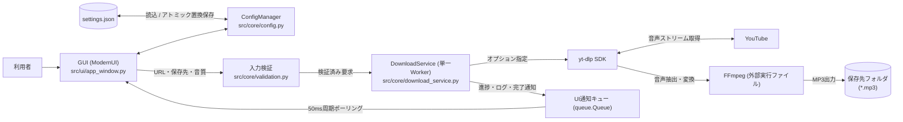

# システム概要（Music DL）

## 1. システムの目的と解決する課題

**Music DL（`music_dl`）** は、利用者が保存する権利または許諾を持つYouTubeの単一動画から音声を取得し、指定したビットレートのMP3ファイルとしてローカルPCに保存するWindows向けデスクトップアプリケーションです。

従来、YouTube上の音声をMP3として手元に保存するには、コマンドラインから `yt-dlp` や `FFmpeg` のオプションを直接指定する必要があり、コマンド操作に不慣れな利用者にとって導入と操作の負担が大きいという課題がありました。

Music DLは、**「URLの入力・貼り付け」「音質（128 / 192 / 320 kbps）の選択」「保存先フォルダの指定」「進捗確認と詳細ログ表示」を単一のGUIウィンドウに集約** し、複雑なコマンド操作を意識せずに安全かつ手軽にMP3保存を行える環境を提供します。

> **権利と利用規約に関する基本原則**
> 本アプリケーションは、利用者が著作権法・YouTube利用規約・必要な許諾を確認したコンテンツのみを対象とします。DRM（デジタル著作権管理）の回避や権利判定の代行は一切行いません。

---

## 2. 想定利用者と利用シナリオ

| 対象ロール | 主な利用シナリオ |
| :--- | :--- |
| **一般利用者** | 権利・許諾を確認済みの単一動画URLを入力し、好みの音質（128k / 192k / 320k）と保存先フォルダを選んでMP3ファイルを保存する。 |
| **導入・運用担当者** | Windows環境へのPython 3.14およびFFmpegの導入、`run.ps1` による初期セットアップ、およびエラー発生時の詳細ログに基づく一次切り分けを行う。 |
| **開発・保守担当者** | GUI層（`src/ui`）とコア層（`src/core`）の保守、依存ライブラリ（`yt-dlp`, `customtkinter`）の互換性確認、単体テスト・静的解析による品質維持を行う。 |

---

## 3. システム全体構成と処理の流れ

Music DLは、画面表示とユーザー操作を担う **プレゼンテーション層（CustomTkinter GUI）** と、入力検証・設定管理・音声取得制御を担う **コア層（Core Services）** を分離したレイヤードアーキテクチャを採用しています。外部通信やデータベースサーバー、ユーザー認証機構は持たず、ローカルPC上で完結して動作します。

### 利用から保存までの基本フロー

1. **起動と環境確認**：起動スクリプト `run.ps1`（または直接起動）によりアプリが立ち上がり、`settings.json` から前回の保存先と音質を復元します。同時に `PATH` 上の `ffmpeg` の存在を確認します。
2. **入力と設定変更**：利用者が単一動画URLを入力（またはクリップボードから貼り付け）し、必要に応じて音質（128k / 192k / 320k）と保存先フォルダを変更します。設定変更時は一時ファイル経由のアトミック置換により `settings.json` が即座に更新されます。
3. **開始前検証**：開始ボタン押下時に、URL形式、プレイリスト除外（`list` パラメータ拒否）、保存先フォルダの存在・書き込み権限、およびFFmpegの利用可否を検証します。
4. **非同期ダウンロードとMP3変換**：検証通過後、バックグラウンドの単一ワーカースレッド（`music-dl-worker`）が `yt-dlp` を呼び出して最良音声を取得し（進捗 `0.00`〜`0.94`）、取得完了後（進捗 `0.95`）にFFmpegでMP3へ変換します。
5. **UI通知と完了**：ワーカースレッドはUI部品を直接触らず、`queue.Queue` を介してメインスレッドへ進捗・ログ・完了（進捗 `1.0`）を通知します。

---

## 4. 対象範囲と対象外（スコープ境界）

| 区分 | 内容 |
| :--- | :--- |
| **対象（In Scope）** | ・YouTubeの単一動画URLの入力・貼り付け ・音声ストリームの取得とMP3形式（128 / 192 / 320 kbps）への変換 ・保存先フォルダと音質設定のローカル保存（`settings.json`） ・単一ジョブ実行制御（二重実行防止）、進捗バー・推定残り時間・画面内詳細ログの表示 |
| **対象外（Out of Scope）** | ・プレイリストや複数URLの一括ダウンロード ・MP3以外のフォーマット出力、動画・字幕・サムネイル保存、メタデータ編集 ・ダウンロードの一時停止・再開・途中キャンセル機能 ・ダウンロード履歴の永続化、永続ログファイル出力、クラウド同期、DRM回避 |

---

## 5. 現在の実装状況と運用・保守方針

1. **実装・テスト状況**
   - GUI（`ModernUI`, `Theme`）、コア機能（`DownloadService`, `ConfigManager`, `validation`）、起動スクリプト（`run.ps1`）、および単体テスト24件・静的解析（Ruff / Black / Pyright）はすべて実装・整備済みです。
2. **保守方針（現状維持モード）**
   - 主要機能は完成しており、新規の機能追加や拡張は予定していません。原則として現状維持とし、YouTube / `yt-dlp` の仕様変更への追従や重大な不具合対応が必要になった場合のみ個別に対応します。
3. **既知の制約と注意点**
   - URL検証において、`/watch?v=...` 以外のパス形式ではYouTubeドメイン上の非空パスを広く通す実装上の許容差があり、動画以外のページURLは `yt-dlp` 実行段階でエラーとなります。
   - 処理中にウィンドウを強制終了した場合、バックグラウンドのデーモンスレッドの完了や未完成の一時ファイルの自動削除は保証されません。
