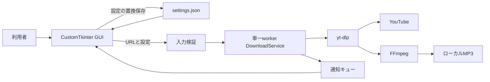

# Music DL システム概要

文書版数: 3.0 / 更新日: 2026-10-25 / 確認基準Git: `95c2ec0d9b289f8548d990d1feb882462ce7f0e0` / 検証区分: 静的確認のみ（製品・正式Gate未実行）

目的は、コマンド操作に不慣れな利用者がURL・音質・保存先を一画面で扱える構成を理解することである。権利・許諾を持つ対象だけを扱い、権利確認をアプリが代行しない。

## 1. 課題・範囲

YouTube音声の取得とFFmpeg変換を個別コマンドで行う負担を減らす。出力はMP3、同時に1件。プレイリスト、一括、他形式、cancel/resume、永続履歴、クラウド同期、DRM回避は対象外。現状維持方針を継承し、機能追加を文書で承認しない。

## 2. 現行構成

次はコードから確認した現行構成で、実サービス接続・実画面は今回未確認。

GUIは入力と表示、coreは検証・設定・取得制御。GUIの直接更新をworkerに任せず、queueを画面threadが処理する。server・DB・利用者認証は持たない。

## 3. 利用・処理の流れ

`run.ps1` はPython/FFmpeg確認、必要時のvenv・依存導入、GUI起動を担当する。設定を読み込み、利用者が単一URL・保存先・128/192/320 kbpsを指定。開始時の入力・FFmpeg検証後、workerで取得・変換、queue経由で進捗・成否を通知する。成功時にMP3が残る。設定変更は原子的に保存する。

## 4. 実装状況と制約

GUI/core/単体テストのコードが存在し、2026-10-16保存先空値修正の承認Evidenceがある。今回テストやGUI、YouTube、FFmpegを起動していない。単一動画を厳密に識別しないURL許容差、終了時worker完了・部分ファイル整理の非保証、性能/アクセシビリティ未決定を維持する。

## 5. 読み進め方

[要件ProjectContext](ProjectContext.md)は既存FR/NFR・受入、[詳細Architecture](Architecture.md)はデータ・内部処理、[UI](UI_design.md)は画面、[用語](Glossary.md)は定義、[外部連携](ExternalIntegrations.md)はSDK・通信の正本。[Usage](UI_design.md#d-98bbb2166f)は導入・運用手順であり変更後の実行成功証明ではない。
